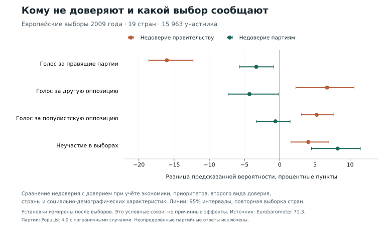

# Первые общие европейские результаты

Статус: сохранённая версия 1. Последующая проверка региональной идентичности
британских Greens выявила один ответ, который должен стать неопределённым.
[Исправление записано отдельно](planning/eb-regional-identity-correction.md);
полный пересчёт уже выполнен. [Исправленные результаты находятся здесь](EUROPEAN_RESULTS_V2.md).
Числа ниже относятся к первоначально зафиксированной выборке и сохраняются
как история первой версии.

Версия от 6 ноября 2026 года. В срезе после европейских выборов 2009 года
недовольство экономикой связано с меньшей поддержкой правящих партий.
При этом общее недоверие партиям заметнее связано с неучастием, чем с выбором
популистской оппозиции. Это первые результаты зафиксированной модели;
проверка временного порядка на предвыборных панелях и национальных выборах
ещё впереди. По этому срезу нельзя установить, что кризис изменил установки
и через них вызвал определённый голос.

## Что сравнивается

Eurobarometer 71.3 задаёт одинаковые вопросы об экономике, приоритетах
и доверии в 27 странах. Все эти ответы получены после выборов Европарламента.
Консервативная таблица партий позволяет сравнить власть с оппозицией
в 25 странах. Два типа оппозиции сравниваются в 19 странах, где проверены
обе альтернативы. Чехия и Венгрия пока исключены из определения ответственной
коалиции из-за временных кабинетов; отдельные списки и независимые кандидаты
остаются вне партийной классификации.

В новом анализе «популистская партия» означает классификацию PopuList 4.0
с пограничными случаями. Она проверяется альтернативными вариантами,
но не подменяет историческую классификацию национальных кампаний WPD.
Из 11 798 названных голосов с полным набором установок классифицированы 9 949.
Остальные 1 849 не получили предполагаемых меток. Явное неучастие кодируется
по отдельному вопросу, а не по отсутствию названной партии.

Главная модель учитывает страну, возраст, пол, образование, занятость,
тип населённого пункта и левую/правую самооценку. Каждая страна получает
одинаковый суммарный вес, внутри неё сохраняются демографические веса опроса.
Экономика, приоритет, доверие правительству и доверие партиям входят вместе.
Последние два признака различаются: во всех 27 странах наблюдаются все
четыре сочетания ответов, хотя некоторые сочетания редки.

Ниже приведены разницы предсказанных вероятностей при заданной смене одного
ответа и сохранении остальных наблюдаемых характеристик. Это способ описать
условную связь модели. Он не воспроизводит эксперимент, в котором исследователь
меняет доверие гражданина. Интервалы получены 1 000 повторными выборками стран.
Они отражают вариацию наблюдаемых стран при выбранной модели, но не включают
неопределённость партийной классификации, систематическую ошибку ответов
или скрытый отбор в классифицированную выборку. Эти ограничения проверяются
отдельными вариантами и не исчезают при узком статистическом интервале.

## Наказание власти и выбор оппозиции дают разные результаты

| Сравнение ответов | Поддержка правящих партий среди классифицированных голосов, п. п. (25 стран) | Популистская партия среди оппозиционных голосов, п. п. (19 стран) |
|---|---:|---:|
| Экономика «скорее плохая» вместо «скорее хорошей» | −5,21 [−7,24; −2,74] | +1,21 [−1,88; +4,50] |
| Недоверие правительству вместо доверия | −33,15 [−38,76; −26,09] | +7,01 [+0,40; +13,03] |
| Экономика, цены или безработица среди приоритетов | +2,95 [−0,57; +6,10] | −9,10 [−13,14; −4,41] |
| Недоверие партиям вместо доверия | +2,34 [−1,14; +5,47] | +2,70 [−2,89; +7,73] |

В первом столбце 9 949 человек, во втором 4 122. Интервалы являются 95%-ными.
Числа в столбцах относятся к разным условным выборкам и не складываются.
Большая связь доверия правительству с голосом за правящие партии ожидаема,
но послевыборный ответ может также выражать уже сделанный политический выбор.

Экономическая оценка различает власть и оппозицию. Для различия между
популистской и другой оппозицией её интервал допускает как отсутствие связи,
так и содержательно заметную положительную связь. Поэтому утверждение
«экономика не имеет значения для популистов» было бы сильнее этих данных.

Экономический приоритет даёт отрицательную связь с популистским выбором
среди оппозиции. Направление сохраняется при всех девяти предусмотренных
вариантах весов, силы регуляризации, покрытия и классификации. Оценки
варьируются от −6,87 до −10,94 пункта. Это ещё не изменение приоритетов:
мы сравниваем разных людей после одного голосования. Состав тем у тех,
кто не назвал экономику, и различия между левыми и правыми популистами
требуют отдельной проверки. Дополнительные измерения ниже ограничивают
этот результат именно вопросом о проблемах страны.

## Что видно, если сохранить неучастие

Условие «человек проголосовал за оппозицию» исключает важный возможный исход:
он мог вообще не участвовать. Поэтому модель четырёх исходов включает
15 963 участника в тех же 19 странах с проверенными альтернативами.

| Сравнение недоверия с доверием | Правящие партии | Другая оппозиция | Популистская оппозиция | Неучастие |
|---|---:|---:|---:|---:|
| Правительству | −16,04 | +6,73 | +5,25 | +4,06 |
| Партиям вообще | −3,33 | −4,29 | −0,61 | +8,23 |

Все значения в процентных пунктах. В пределах строки они суммируются в ноль,
поскольку модель распределяет вероятность между четырьмя исходами.

Для общего недоверия партиям интервал связи с популистским голосом составляет
[−3,30; +1,48] пункта, а с неучастием [+4,50; +11,45]. Таким образом, в этой
спецификации более ясная связь общего недоверия относится к неучастию.
В отдельном сравнении неучастия с классифицированным голосом в 25 странах
оценка равна +8,71 пункта [+5,62; +11,29]. При смене весов и ограничении
странами с покрытием партий не менее 90% знак сохраняется.

## Добавляют ли новые показатели информацию на отложенных ответах

Проверка делит участников на пять частей внутри каждой страны. Модель
обучается на четырёх и оценивается на оставшейся, затем части меняются.
Дополнительная проверка целиком исключает страну из обучения. Нормирование
весов и кодирование категорий выполняются только на обучающей части.
Поскольку установки послевыборные, это не прогноз ещё не состоявшихся выборов.

Блок экономики и отношения к правительству уменьшает log loss для различия
власти и оппозиции на 8,71% относительно модели с контролями. Этот показатель
оценивает качество предсказанных вероятностей; меньшее значение лучше.
Добавление общего доверия партиям после экономики, правительства и приоритетов
не улучшает этот результат. Для различия двух оппозиций оно также не улучшает
качество: относительное изменение составляет −0,09%, интервал [−0,41%; +0,18%].

Для неучастия добавление доверия партиям даёт небольшое улучшение на 0,45%
[+0,16%; +0,74%]. Оно меньше заранее выбранного рабочего порога 1%.
В модели четырёх исходов добавка составляет 0,23% [+0,01%; +0,44%].
Статистическая связь и существенное улучшение предсказания являются разными
критериями. Положительная оценка одного не означает автоматического
выполнения другого.

При переносе на целую неучаствовавшую в обучении страну полная модель
различия оппозиций улучшает log loss относительно базовой лишь на 0,54%,
с интервалом [−2,28%; +3,34%]. Общий перенос не подтверждён. Интервалы качества
получены повторной выборкой стран из уже рассчитанных отложенных ошибок;
они учитывают различия между странами, но не переобучают все модели заново
в каждой повторной выборке.

## Что ещё может изменить интерпретацию

Исключение каждой страны по очереди не меняет знак трёх основных оценок:
экономическая неудовлетворённость связана с меньшей поддержкой власти
(от −5,89 до −4,56 пункта), национальный экономический приоритет с меньшей
поддержкой популистов среди оппозиции (от −10,44 до −7,80), а партийное
недоверие с неучастием (от +8,03 до +9,40). Эти диапазоны показывают
влияние отдельных стран, а не являются новыми доверительными интервалами.
В отдельных страновых моделях направления различаются, причём некоторые
из них основаны всего на пяти наблюдениях меньшего исхода. Считать такие
оценки равнозначными доказательствами национальных механизмов нельзя.

Формулировка приоритета меняет результат. На одной и той же выборке
из 3 900 оппозиционных избирателей национальный экономический приоритет
даёт −9,85 пункта, а личный экономический приоритет +1,75. При рассмотрении
национальных тем отдельно оценки составляют −5,54 для экономики,
−2,22 для цен и +0,15 для безработицы. Это точечные оценки без новых
интервалов. Они не позволяют говорить о единой связи любых экономических
забот с популистским голосом. Вопрос о проблемах страны и вопрос о личных
трудностях измеряют разные вещи.

Различаются и объекты доверия. После добавления отношения к ЕС оценка
партийного недоверия для выбора популистов среди оппозиции уменьшается
с +2,64 до +0,64 пункта на той же выборке из 3 797 человек. Замена доверия
партиям доверием парламенту даёт +6,77 пункта вместо +2,78 на совпадающей
выборке. Парламентское недоверие может отражать отношение к иной политической
мишени; его нельзя молча использовать как синоним партийного.

Неопределённые партии особенно важны для отдельных стран. Среди сообщивших
о голосовании и ответивших на основные вопросы взвешенная неопределённая
доля составляет 38,85% во Франции, 37,67% в Латвии и 34,86% в Эстонии.
Столь широкие арифметические границы не дают надёжно оценить долю каждой
категории во всей стране. Это границы долей, не коэффициентов модели.
В Чехии и Венгрии неопределённость относится ко всем голосам из-за решения
не приписывать ответственность временным кабинетам.

Для сравнения участия партийная классификация вообще не обязательна.
Если включить все явные сообщения о голосовании, оценка партийного недоверия
для неучастия составляет +7,96 пункта на 21 966 ответах в первоначальных
25 странах и +7,75 на 23 876 ответах во всех 27. Связь сохраняется,
хотя её размер немного меньше первичной оценки +8,71.

Фиксированный градиентный бустинг также не подтверждает общее различение
двух оппозиций добавленным блоком установок. Полная модель улучшает log loss
относительно своих базовых контролей на 1,35% [−1,50%; +4,20%] внутри стран
и на 1,13% [−1,74%; +4,38%] при переносе в другую страну. Оба интервала
включают отсутствие улучшения. Для различия власти и оппозиции нелинейная
полная модель заметно лучше линейной, однако добавленный блок улучшает
её собственную базу лишь на 0,81% [−2,37%; +3,66%]. Поэтому величину
линейного улучшения 8,71% нельзя считать общей мерой уникальной информации
экономических установок. Нелинейная модель может использовать взаимодействия
контрольных признаков, включая страну и идеологию.

Первая модель подтверждает необходимость различать отношение к действующему
кабинету, отношение к партиям вообще и участие в голосовании. Она пока
не проверяет, в каком порядке эти установки изменились. Для этого нужны
GLES и BES с измерениями до выборов.

До итогового вывода остаются предвыборные панели, национальные выборы
и связь установок с предложением партий. Изменения формулировок,
отбор в панель и появление новых партий сохраняют самостоятельное значение.
Результат по европейским выборам 2009 года нельзя автоматически переносить
на поздние национальные выборы после кризиса.

Числа воспроизводятся скриптами 50–55 из локально полученного файла GESIS.
Спецификация зафиксирована до оценки связей в коммите `a59f22b`, протокол
в `bdbd371`. Проверены совпадение входных контрольных сумм, сумма вероятностей,
соответствие общего качества среднему по странам, все 64 сочетания исхода,
блока и способа проверки и завершение 1 000 повторных выборок для каждой
основной разницы. Дополнительные проверки зафиксированы в `e9fe872`
после первых линейных результатов и до собственных расчётов. Проверены
88 исключений стран, 48 пар основной и альтернативной спецификации, 15 сочетаний
нелинейного обучения и проверки, сохранение сумм вероятностей и совпадение
выборок альтернативных измерений. Строки респондентов не экспортировались. Эти проверки
подтверждают выполнение расчёта, но не устраняют ограничения дизайна.
